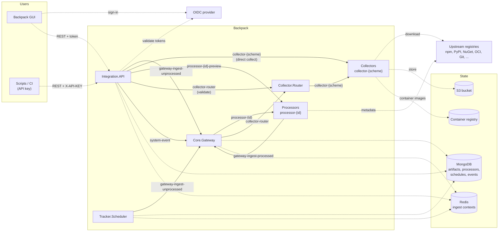
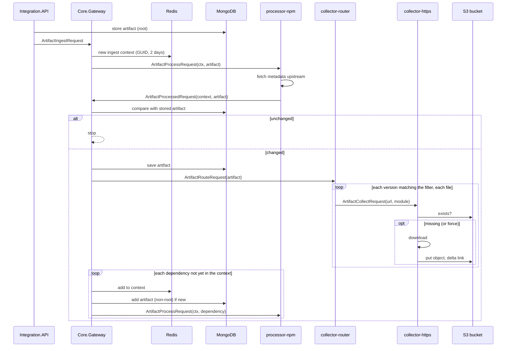

# Architecture Diagrams

## Components

Solid arrows are RabbitMQ messages (labelled with the queue), dashed arrows are other
connections.

- The **API** is the only entry point for users. It writes artifacts and settings to
  MongoDB and starts work by sending messages. Only previews wait for an answer
  (request/response).
- **Tracker.Scheduler** runs the re-track schedules stored in MongoDB.
- **Core.Gateway** is the only service that interprets processor results: it detects
  changes, stores them, and fans out to the router and to dependencies.
- **Processors** only read upstream metadata. **Collectors** only download and store.
  Neither uses MongoDB or Redis.
- `direct_collect` processors skip the gateway, processors and router: the artifact ID is
  the URL handed to a collector.

## Processing an artifact

See [Troubleshooting](Troubleshooting.md) for each step in detail and
[Storage Architecture](../STORAGE.md) for the object layout.
